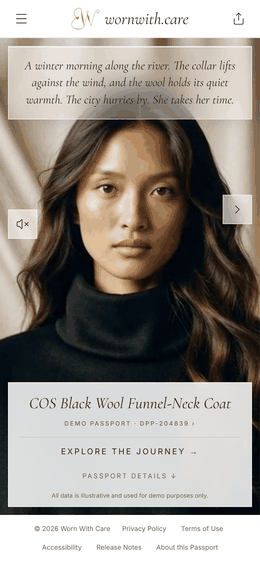
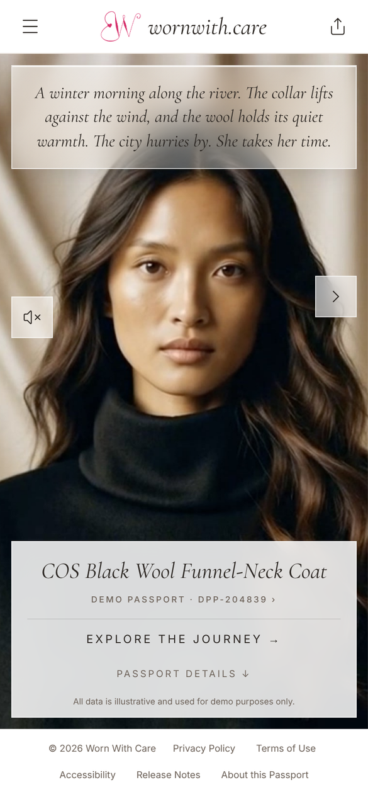
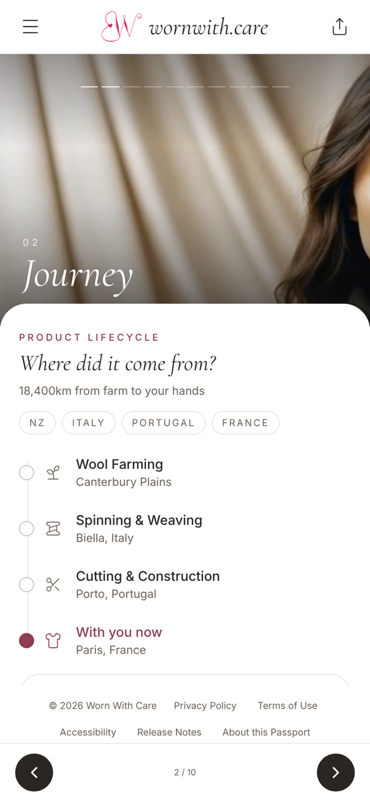
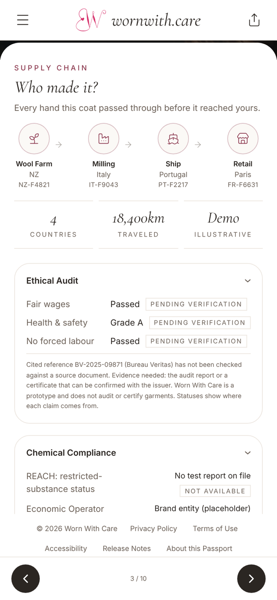
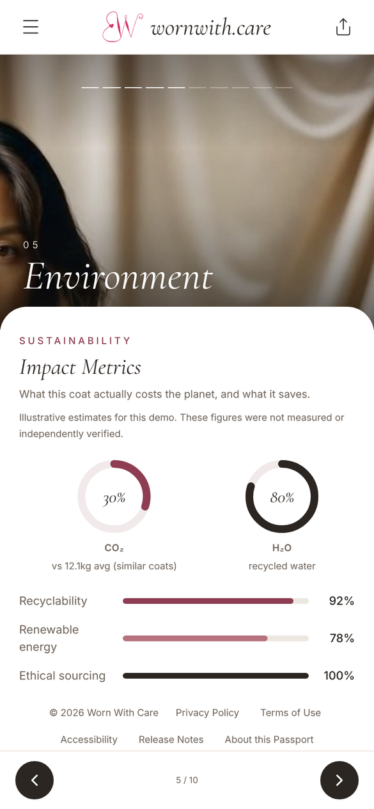

# Worn With Care

[](https://github.com/elizabethxuu/wornwith-app/actions/workflows/ci.yml)

**A digital product passport for fashion, designed as a product people want to open, not a compliance page they have to.**

Scan a garment's tag and you get its story: where it was made, how to care for it, what it costs the planet, and what to do when you are finished with it. Every claim is meant to show where it comes from, so the passport never promises more than it can prove.

**Live:** https://wornwith.care &nbsp;|&nbsp; **Languages:** [English](https://wornwith.care/en) · [Français](https://wornwith.care/fr) · [Português](https://wornwith.care/pt) &nbsp;|&nbsp; **Case study:** [docs/product-case-study.md](docs/product-case-study.md)

<p align="center">
  
</p>

<p>
  
  
  
  
</p>

> **Prototype notice.** This is an independent portfolio project built around one demonstration garment. The garment details and sustainability figures are illustrative and have not been independently verified. Worn With Care is not an audit or certification body, is not an official EU verification system, and is not affiliated with any brand shown. It does not claim ESPR compliance.

## The problem

The EU's Ecodesign for Sustainable Products Regulation (ESPR) introduces digital product passports across many product groups, and the rules for textiles are still being defined. The regulation sets out what information must exist. It does not say what the experience should feel like, and the easy default is a PDF behind a link in the footer.

I wanted to find out whether a passport can be both honest and genuinely good to use, and whether it can give a brand a lasting relationship with the person who owns the garment.

## Who it is for

- **The considered shopper.** Buys fewer, better things. Wants to know where a garment came from and how to make it last. Today gets either nothing or a disclosure page that reads like a warranty card.
- **The brand.** Needs to publish product information anyway, and could turn that obligation into an ongoing channel after the sale.

It is deliberately not for the price-driven, low-consideration shopper.

## What it does

| Area | What you can do |
| --- | --- |
| **Overview** | See the garment, its identity and composition |
| **Journey** | Follow the garment from wool farm to mill, ship and retail, with locations and audit information |
| **Care** | Get care guidance that responds to how often the garment is worn |
| **Environment** | See impact estimates compared with a category average |
| **Ownership** | Log purchase details, condition and personal "moments" with the garment |
| **Next chapter** | Route the garment to resale, donation, repair or recycling |
| **Wardrobe** | Keep several pieces together with contextual suggestions |
| **Sharing** | Share by link, QR code or a PDF export, and print a physical tag |
| **Voice** | Record voice notes and hear narration, using ElevenLabs text-to-speech and speech-to-text (needs an API key; recordings still save without one) |
| **Languages** | English, French and Portuguese, with the language in the URL (`/en`, `/fr`, `/pt`) |

## Product decisions

- **Distinguish where information comes from.** Brand or manufacturer information, owner records, estimates and demonstration data are different things and should look different. The prototype labels demonstration values as illustrative rather than dressing them up as verified.
- **Show where each claim comes from.** Audit and chemical claims carry a status (for example Pending verification or Not available) and say what evidence would be needed. A cited reference number is shown as cited, never as verified.
- **Do not overclaim.** No claims of independent verification, regulatory compliance, blockchain anchoring or brand endorsement without evidence. A QR code opens a page; by itself it does not prove a garment is authentic.
- **Make the garment the focal point.** Quiet editorial design (ivory, near-black, muted rose, serif headings) so the information feels considered, not like a dashboard.
- **Make links dependable.** Language lives in the URL, so a shared link opens in the right language and survives a refresh. The live passport is the default on both phone and desktop, and the presentation deck is an explicit option (`?mode=deck`).
- **Scope on purpose.** One garment, one journey. Authoring tools, multi-brand data and commerce are out of scope for this build.

## What is real and what is not

| Built and working | Illustrative or not yet built |
| --- | --- |
| Full passport experience across ten screens | All garment data and impact figures are sample data |
| EN / FR / PT with language URLs | No independent audit, lab testing or verification has taken place |
| QR, link sharing, PDF export, printable tag, all using one clean address | Data is stored in the visitor's browser only, with no accounts and no cloud sync |
| Ownership logging saved in the browser | The brand-side incentive model is a hypothesis, not yet tested with a real brand |
| AI-assisted reflections on saved moments, labelled as an interpretation (when the API keys are configured) | Textile passport requirements under ESPR are not final |

## What I would measure in a pilot

There is no live pilot yet. These are the metrics I would track from day one:

- **Scan-to-read-through:** share of sessions that get past the overview.
- **Moment-logging rate:** share of owners who complete the ownership prompt, as a signal of real buy-in.
- **Return visits:** owners reopening the passport after purchase.
- **First-party data yield:** structured data per garment (moments, repairs, resale intent).

## Risks and next steps

1. **Data provenance.** Environmental figures need a defensible sourcing method and a clear liability model before real use.
2. **Scalable data model.** The prototype assumes one SKU. A real catalogue needs many mills, certificates and versioned supply chains.
3. **Extend claim status labels.** The audit and chemical claims show a status today. Bring the same labels to materials, environmental figures and origin, with the evidence needed to verify each.
4. **Brand validation.** Test the resale and repair routing idea against a real brand's numbers.
5. **Regulation.** Track the textile requirements as they are finalised.

## How it was built

Designed and built solo, end to end: product definition, UX, content, translation, front end and deployment. Planned in Figma, built with AI-assisted tools (Claude and Cursor), and deployed on Vercel.

**Stack:** React, TypeScript, Vite, Tailwind CSS, Vercel serverless functions, jsPDF, QR code generation, Lucide icons.

## Project structure

- `src/`: the React app (screens, components, translations and helpers)
- `api/`: Vercel serverless functions for AI reflections, voice narration and transcription
- `public/`: images, video and icons
- `docs/`: the product case study and screenshots
- `vercel.json`: routing for the /en, /fr and /pt language paths
- `.env.example`: template for environment variables (no real keys)
  
## Run it locally

```bash
git clone https://github.com/elizabethxuu/wornwith-app.git
cd wornwith-app
npm install
npm run dev
```

```bash
npm run dev      # development server
npm run build    # type checks and production build
npm run lint     # Oxlint
npm test         # API tests (Node's built-in test runner)
npm run preview  # preview the built frontend
```

The AI features run as Vercel serverless functions in `api/` and need provider keys set in the deployment environment (see `.env.example`). Never commit real keys. The plain Vite dev server does not run those functions.

## Deployment

Vite front end with an `api/` folder for Vercel functions, served at https://wornwith.care. Review changes on a branch, run `npm run lint`, `npm test` and `npm run build` (a GitHub Action runs the same checks on every pull request), check a Vercel preview, then promote.

## About

Worn With Care is by [Elizabeth Xu](https://github.com/elizabethxuu).
